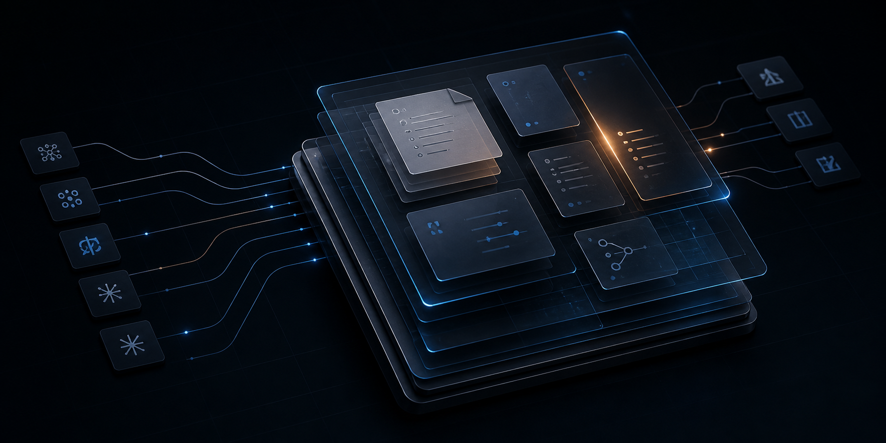
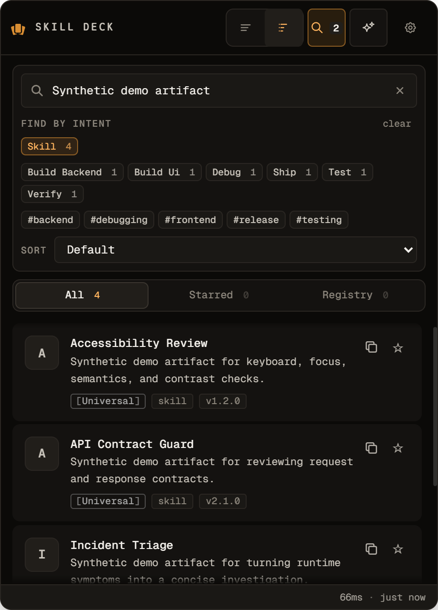
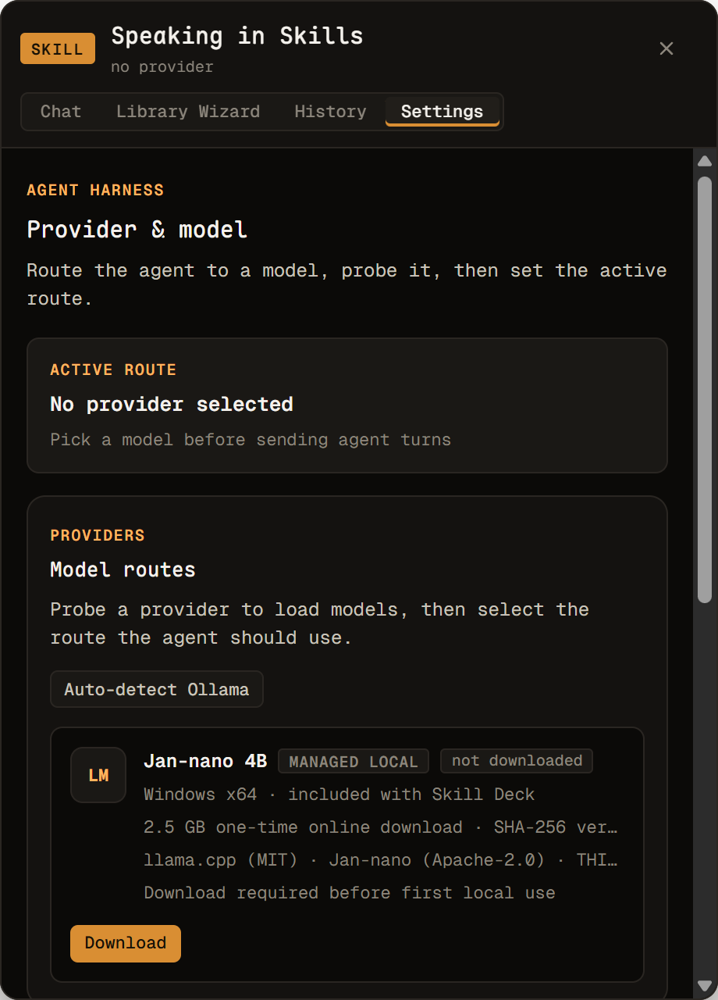

# Skill Deck

**Durchsuchbarer Katalog für Skills, Regeln, Prompts und Provider von KI-Coding-Agenten.**

[English README](README.en.md)

<p align="center">
  
</p>

[](https://github.com/OthmanAdi/skill-deck/actions/workflows/ci.yml)
[](CHANGELOG.md)
[](#plattformunterstützung)
[](LICENSE)

KI-Coding-Agenten nutzen Skills, Regeln, Befehle, Hooks und Systemprompts. In Unternehmen und größeren Entwicklungsumgebungen ist jedoch oft unklar, wo diese Artefakte liegen, was sie können, welche Anweisungen sie enthalten und über welche Provider oder lokalen Modellpfade sie ausgeführt werden.

Skill Deck macht diesen Bestand sichtbar. Die Windows-Desktop-App findet dokumentierte Agenten-Artefakte, vereinheitlicht sie in einem lokalen Katalog und macht Inhalte, Einstellungen und Provider durchsuchbar. Das hilft bei Inventarisierung und manueller Prüfung, ersetzt aber weder ein Security-Audit noch eine automatische Erkennung von Prompt Injection.

Version 0.3.0 ist eine vollständig freigeschaltete Einzelausgabe. Es gibt keine Free/Pro-Trennung, Preise, Produktaktivierung, Lizenzschlüsselprüfung oder bezahlte Funktionssperre.

## Warum Skill Deck?

- **Verteilte Agenten-Artefakte:** Claude Code, Codex, Cursor, Copilot, Windsurf, Gemini CLI und weitere Werkzeuge verwenden unterschiedliche Dateien und Verzeichnisse.
- **Unklare Herkunft und Fähigkeiten:** Ohne gemeinsamen Katalog ist schwer nachvollziehbar, welche Skills installiert sind, woher sie stammen und welche Befehle oder Hooks sie bereitstellen.
- **Prompt-Injection-Risiken brauchen Sichtbarkeit:** Skill Deck zeigt lokale Inhalte zur Prüfung an. Es bewertet oder zertifiziert ihre Sicherheit nicht automatisch.
- **Provider und Modelle werden schnell unübersichtlich:** Die App macht konfigurierte Provider, das verwaltete lokale Modell und relevante Einstellungen an einer Stelle sichtbar.
- **Lokale Arbeitsweise:** Suche, Filter, Favoriten, Snapshots, Verlauf und lokale Harness-Protokolle bleiben auf dem Rechner. Netzwerkzugriffe sind unten ausdrücklich dokumentiert.

## Funktionen

- Durchsucht die dokumentierten globalen und projektbezogenen Ablageorte von 56 Coding-Agenten sowie das universelle Format `AGENTS.md`.
- Vereinheitlicht Skills, Regeln, Commands, Hooks, Prompts, Workflows und Konfiguration in einem gemeinsamen Artefaktmodell.
- Bietet Live-Suche, Filter, gruppierte Ansichten, Kartenansicht, Favoriten, Update-Prüfung und Snapshot-Verlauf.
- Durchsucht öffentliche Skills auf skills.sh und ClawHub.
- Führt skillbezogene Chat-Sitzungen mit Kontextkomprimierung, Werkzeugen und lokalen Sitzungsdaten aus.
- Unterstützt das verwaltete lokale Modell Jan-nano 4B, einen lokalen Ollama-Endpunkt oder einen benutzerdefinierten Azure-kompatiblen Provider.
- Öffnet sich über ein konfigurierbares globales Tastenkürzel und unterstützt Tray-, Pin- und Auto-Hide-Modi.

## Screenshots

<table>
  <tr>
    <td></td>
    <td></td>
  </tr>
  <tr>
    <td align="center"><strong>Durchsuchbarer Skill-Katalog</strong></td>
    <td align="center"><strong>Agenten-, Provider- und Modelleinstellungen</strong></td>
  </tr>
</table>

Die Aufnahmen zeigen Skill Deck 0.3.0 auf Windows x64 mit synthetischen Demo-Artefakten. Die zugehörigen Aufnahmeinformationen stehen in `media/screenshots/CAPTURE_RECEIPT.md`.

## Plattformunterstützung

Das aktuell qualifizierte Ziel ist **Windows 10/11 x64**. Der Quellcode enthält weiterhin Adapter für macOS und Linux, für Version 0.3.0 werden jedoch keine qualifizierten nativen Pakete für macOS, Linux, Windows ARM64 oder App Stores behauptet.

Eine öffentliche Binärversion gilt erst dann als veröffentlicht, wenn ein signiertes Artefakt auf der GitHub-Releases-Seite vorhanden ist. Lokale Entwickler-Builds sind unsigniert. Der Tag-Workflow darf kein GitHub Release erzeugen, wenn die Authenticode-Konfiguration fehlt oder eine Windows-Signatur ungültig ist.

## Unter Windows aus dem Quellcode bauen

### Voraussetzungen

- Windows 10 oder 11 auf x64
- [Node.js 22.23.1](https://nodejs.org/)
- Corepack mit pnpm 10.13.1, festgelegt in `package.json`
- [Rust stable](https://rustup.rs/)
- [Windows-Voraussetzungen von Tauri](https://v2.tauri.app/start/prerequisites/), einschließlich Microsoft C++ Build Tools und WebView2

### Installieren und starten

```powershell
corepack enable
pnpm install --frozen-lockfile
pnpm tauri dev
```

Mit `Ctrl+Shift+K` wird das Overlay ein- oder ausgeblendet. Das Tastenkürzel lässt sich in den Einstellungen ändern.

### Prüfen und bauen

```powershell
pnpm check
pnpm compliance:test
Push-Location src-tauri
cargo test --locked
cargo clippy --locked -- -D warnings
Pop-Location
pnpm tauri build
```

Die Windows-Buildausgabe liegt unter `src-tauri/target/release/`. Ein lokaler Build ist kein offizielles Release und nicht vom Projekt signiert.

## Unterstützte Agenten und Formate

| Ökosystem | Beispiele gefundener Artefakte |
|---|---|
| Claude Code | `SKILL.md`, Slash Commands, Agenten, Plugins, Settings Hooks |
| Codex | `SKILL.md`, `AGENTS.md` |
| Cursor | Skills, `.mdc`-Regeln, `.cursorrules` |
| GitHub Copilot | `.prompt.md`, `.instructions.md`, `copilot-instructions.md` |
| Windsurf | Skills, Regeln, `.windsurfrules` |
| Gemini CLI | `SKILL.md`, `GEMINI.md` |
| Cline, Roo Code, Continue | Skills und agentenspezifische Regeldateien |
| Aider, Amazon Q, JetBrains AI, Tabnine, Augment | Dokumentierte globale und projektbezogene Artefaktspeicher |
| OpenCode, Crush, Amp, Antigravity, Goose, Kilo, Qwen, Kimi, Droid, Warp, Zencoder und weitere | Skills in Agentenspeichern und im gemeinsamen Pfad `~/.agents/skills` |
| Universal | `AGENTS.md` |

Der vollständige Discovery-Vertrag steht in [docs/skill-discovery.md](docs/skill-discovery.md).

## Datenschutz und Netzwerkzugriffe

Discovery, Parsing, Filter, Favoriten, Snapshots, Chatverlauf und Harness-Telemetrie werden lokal verarbeitet und gespeichert. Skill Deck betreibt keinen eigenen Produkt-Telemetriedienst und lädt gefundene Artefakte standardmäßig nicht hoch.

Einige Funktionen verwenden bewusst das Netzwerk:

- Die Marketplace-Suche fragt skills.sh und ClawHub ab.
- Skill-Update-Prüfungen fragen die konfigurierte GitHub-Quelle ab.
- Websuche und Web Fetch kontaktieren den ausgewählten Suchanbieter oder die angeforderte Seite, wenn diese Werkzeuge benutzt werden.
- Bei Nutzung eines entfernten KI-Providers erhält dieser die Unterhaltung und den ausgewählten Kontext. Provider-Zugangsdaten werden lokal gespeichert und in der Oberfläche maskiert ausgegeben.
- Das verwaltete Jan-nano-Modell wird bei der ersten Nutzung aus einer festgelegten Hugging-Face-Revision geladen, mit SHA-256 geprüft und danach lokal über die mitgelieferte Windows-x64-Laufzeit von llama.cpp bereitgestellt.

Vor der Verarbeitung sensibler Inhalte sollten Provider-, Webtool- und Modelleinstellungen geprüft werden. Hinweise zur privaten Meldung von Schwachstellen stehen in [SECURITY.md](SECURITY.md).

## Architektur

```text
dokumentierte Agentenpfade
          |
          v
Rust Registry + Scanner -> Parser -> universelles Skill-Modell
          |                              |
          |                              v
          +-----------------------> Svelte-5-Overlay
                                         |
                                         v
                              lokale Einstellungen und Historie
```

| Bereich | Verantwortung |
|---|---|
| `src-tauri/src/agents/` | Agenten-Registry, dokumentierte Orte und Dateisystem-Scan |
| `src-tauri/src/parsers/` | Markdown-, Frontmatter- und Settings-Hook-Parsing |
| `src-tauri/src/models/` | Universelle IPC-Datenstrukturen |
| `src-tauri/src/detection/` | Discovery-Metadaten, Repositories, Marketplaces, Updates und Snapshots |
| `src-tauri/src/harness/` | Provider, Tools, Kontextverwaltung, Modell-Lebenszyklus und lokale Telemetrie |
| `src/lib/` | Svelte-5-Komponenten, Stores, Typen und Darstellung |
| `src/routes/` | Einstiegspunkt des Desktop-Overlays |

Die Oberfläche kennt keine agentenspezifischen Quellformate. Jeder Adapter erzeugt dasselbe universelle Modell, bevor Daten die Tauri-IPC-Grenze passieren.

## Einen Agenten ergänzen

1. Agentenkennung in `src-tauri/src/models/skill.rs` ergänzen.
2. Dokumentierte Pfade und Format in `src-tauri/src/agents/registry.rs` eintragen.
3. Nur dann einen Parser hinzufügen, wenn das Format nicht über die bestehende Markdown-/Frontmatter-Pipeline verarbeitet werden kann.
4. Fokussierte Scanner- und Parser-Tests ergänzen und `docs/skill-discovery.md` aktualisieren.

Der vollständige Entwicklungs- und Pull-Request-Ablauf steht in [CONTRIBUTING.md](CONTRIBUTING.md).

## Releases und Integrität

Windows-Releases werden durch `v*`-Tags ausgelöst. Der Workflow prüft den Quellstand, verlangt konfigurierte Azure Artifact Signing-Werte, signiert die portable Anwendung vor dem Bundling, signiert beide Installer und prüft anschließend jede Authenticode-Signatur. Erst danach werden Checksummen und Release-Evidence erzeugt und ein GitHub Release angelegt. Es gibt keinen Fallback für unsignierte offizielle Binärdateien.

Die Release-Evidence enthält unter anderem eine CycloneDX-SBOM, ein Inventar deklarierter Abhängigkeitslizenzen, Checksummen, Laufzeit- und Notice-Belege sowie Prüfungen auf unerwünschte Buildpfade. Diese technische Evidence ersetzt keine rechtliche Prüfung und ist keine Security-Zertifizierung.

## Drittanbieter- und Modellhinweise

Der Quellcode von Skill Deck steht unter der Mozilla Public License 2.0 (`MPL-2.0`). Mitgelieferte und heruntergeladene Komponenten behalten ihre eigenen Lizenzen und Zuordnungen:

- Aktive Drittanbieterhinweise: `src-tauri/resources/THIRD_PARTY_NOTICES.txt`
- Komponentenlizenzen: `src-tauri/resources/licenses/`
- Lokale Windows-x64-Laufzeit: festgelegter llama.cpp-Build unter MIT-Lizenz
- Jan-nano 4B Q4_K_M: Download bei Bedarf aus einer festgelegten Revision; Modellkarten-Metadaten deklarieren Apache-2.0. Revision, Größe, SHA-256, Zuordnung und Lizenztext sind bei den Laufzeithinweisen dokumentiert.
- Der Notice-Korpus unter `release/legal-corpus/` dient der Compliance-Prüfung und ist keine Rechtsberatung.

Die Projektlizenz gilt für den von Skill Deck veröffentlichten Quellcode. Sie ersetzt oder verändert keine Drittanbieter-, Laufzeit- oder Modelllizenz.

## Autor

Skill Deck wird in Berlin von **Ahmad Othman Ammar Adi**, einem syrischstämmigen Softwareentwickler, entwickelt und veröffentlicht. Der Schwerpunkt liegt auf nachvollziehbaren, lokalen Werkzeugen für die praktische Arbeit mit KI-Coding-Agenten. Die vollständigen Angaben stehen in [AUTHORS.md](AUTHORS.md).

## Mitwirken

Fehlerberichte, fokussierte Korrekturen, Dokumentation, neue Agentenadapter und Parser-Tests sind willkommen. Bitte vor der Mitarbeit [CONTRIBUTING.md](CONTRIBUTING.md) und den [Code of Conduct](CODE_OF_CONDUCT.md) lesen.

Sicherheitsprobleme gehören nicht in öffentliche Issues. Der private Meldeweg steht in [SECURITY.md](SECURITY.md).

## Lizenz

Skill Deck wird unter der [Mozilla Public License 2.0](LICENSE) veröffentlicht. Copyright (c) 2026 Ahmad Othman Ammar Adi. Drittanbieter- und Modelllizenzen bleiben davon unberührt.
